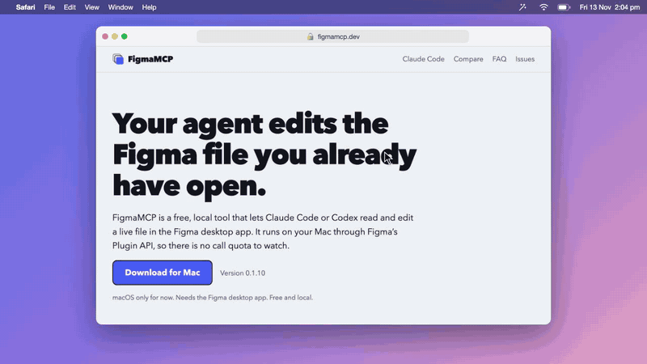

# FigmaMCP

**Let Claude Code or Codex read and edit the Figma file you already have open.** A free Mac app with a local MCP server and a Figma plugin. No Figma API token, and no call quota to watch.

**[Download for Mac](https://figmamcp.dev/download)** · [Website](https://figmamcp.dev) · [Setup guide](https://figmamcp.dev/docs/setup)

*The terminal text in the demo is staged. The Figma frames are real screenshots.*

## How it works

1. **Download and open the app.** It checks for Figma, Claude Code and Codex.
2. **Click through the checklist.** The app adds the plugin to the Figma desktop app and connects the MCP server to your AI. There is no manifest to import and no config file to edit.
3. **Ask your AI.** Open a Figma file and ask for a change. The AI reads the file first, then edits it in place while you watch.

FigmaMCP works through Figma's Plugin API on your own machine. It makes no calls to Figma's hosted MCP server.

## What the AI can do

| Area | Tools |
|---|---|
| Read | `page_info`, `node_info`, `node_export_visual`, `component_list`, `style_list`, `variable_list`, `annotation_list`, `reaction_list` |
| Create | `create_frame`, `create_text`, `create_shape`, `create_svg`, `create_component`, `create_component_set`, `create_instance` |
| Edit | `node_set_fill`, `node_set_stroke`, `node_set_effects`, `node_set_corner_radius`, `node_set_auto_layout`, `node_transform`, `node_rename`, `node_clone`, `node_group`, `node_delete`, `text_set_content`, `text_set_style` |
| Design system | `style_manage`, `variable_manage`, `node_bind_variable`, `node_apply_style`, `component_manage_property`, `instance_set_property`, `instance_set_overrides` |

## Safety

- Every edit must name its exact target layer.
- A bulk edit with one invalid item changes nothing.
- A switch in the plugin makes the file read-only for the AI.
- Two AI sessions can work in one file; one cannot overwrite a layer the other is editing.

## Requirements

- macOS (Windows and Linux are not supported yet)
- The Figma desktop app
- Claude Code or Codex

## Report a problem

[Open an issue](https://github.com/MrCoder/figmamcp-releases/issues/new/choose), or write to support@figmamcp.dev. Do not attach private design files or secrets.

## About this repository

This repository holds downloads and issue reports. It has no source code. Downloads are on the [Releases page](https://github.com/MrCoder/figmamcp-releases/releases).

FigmaMCP is a fork of [figma-edit-mcp](https://github.com/neozhehan/figma-edit-mcp) by Neo Product LLC. It includes third-party software; see [THIRD_PARTY_NOTICES.txt](THIRD_PARTY_NOTICES.txt). Not affiliated with or endorsed by Figma, Inc.
